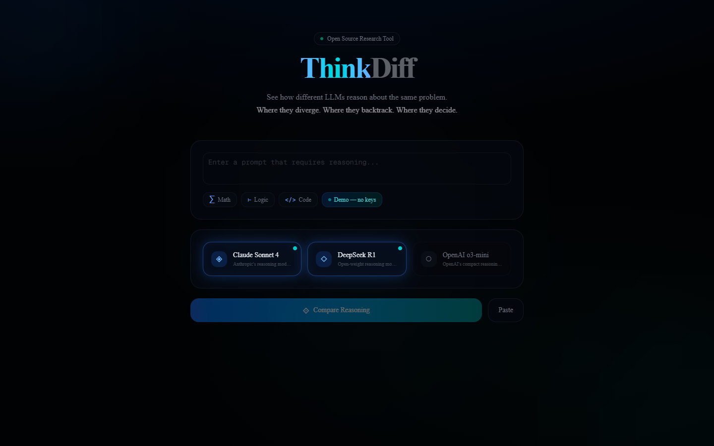
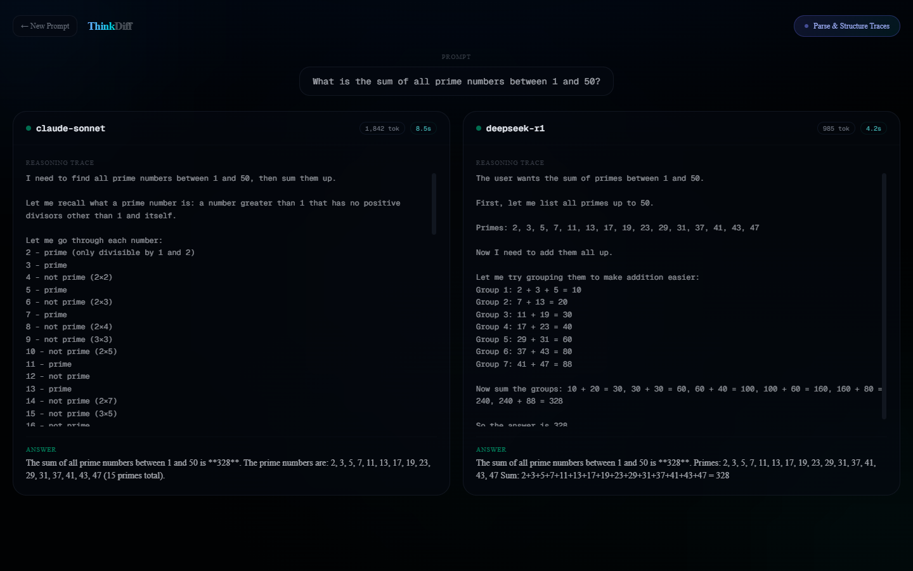

# ThinkDiff

[](https://github.com/kishormorol/thinkdiff/actions/workflows/ci.yml)
[](LICENSE)
[](https://nextjs.org)
[](CONTRIBUTING.md)

**Compare how LLMs reason.** Submit a single prompt to multiple reasoning models and visualize their thinking processes side-by-side — revealing where they diverge, backtrack, and arrive at answers through fundamentally different cognitive paths.

> Different LLMs don't just give different answers — they *think* differently. ThinkDiff captures the full reasoning trace from each model and turns it into interactive, explorable visualizations.

<p align="center">
  
  
</p>

---

## What It Does

ThinkDiff sends the same prompt to up to **3 reasoning models** simultaneously, captures their extended thinking / chain-of-thought, and provides **5 visualization modes** to analyze how they reason:

### Supported Models

| Model | Provider | Reasoning Method |
|---|---|---|
| **Claude Sonnet 4** | Anthropic | Extended thinking (native) |
| **DeepSeek R1** | DeepSeek | Reasoning content |
| **o3-mini** | OpenAI | Medium-effort reasoning |

### Visualization Modes

**1. Side-by-Side Panels** — Each model's trace in its own card with 5 sub-tabs (Steps, Tree, Replay, Raw, Metrics)

**2. Aligned Comparison** — Phases auto-aligned across models so you can see exactly where reasoning diverges, with a quantitative divergence score

**3. Trace Tree** — Interactive graph (pan/zoom) showing the hierarchy: root → phases → individual steps → answer. Color-coded by phase type with animated entry.

**4. Reasoning Replay** — Animated step-by-step playback of each model's thinking process, with speed control (0.5x–4x) and a phase-segmented progress bar

**5. Metrics Dashboard** — Token counts, execution time, phase distribution charts, backtrack frequency, and reasoning style classification (Linear / Exploratory / Iterative)

---

## How It Works

### 1. Input
Enter a prompt or choose from examples (Math, Logic, Code). Select which models to compare. Alternatively, **paste traces manually** from external sources.

### 2. Execute
ThinkDiff calls each model's API in parallel, capturing the full reasoning trace (extended thinking / chain-of-thought) and the final answer.

### 3. Parse & Structure
Raw traces are sent to Claude Haiku, which semantically parses them into a structured hierarchy:

**6 Phase Types** (reasoning chunks):
| Phase | Description | Color |
|---|---|---|
| Understand | Reading/interpreting the problem | Blue |
| Plan | Deciding on an approach | Purple |
| Execute | Carrying out calculations/logic | Green |
| Evaluate | Checking work or alternatives | Yellow |
| Backtrack | Realizing mistake, changing direction | Orange |
| Verify | Confirming final answer | Teal |

**6 Step Types** (individual reasoning statements):
| Step | Icon | Description |
|---|---|---|
| Assertion | → | Stating a fact or result |
| Question | ? | Asking a sub-question |
| Hypothesis | ~ | Proposing a possibility |
| Contradiction | ✕ | Finding an error |
| Conclusion | ✓ | Reaching a result |
| Backtrack | ↩ | Abandoning a line of reasoning |

### 4. Visualize & Compare
All 5 visualization modes render from the structured data, letting you explore reasoning patterns from multiple angles.

---

## Divergence Analysis

ThinkDiff computes a **divergence score** (0–150+) between any two traces:

| Score | Classification | Meaning |
|---|---|---|
| 0–29 | Similar | Models reason in roughly the same way |
| 30–79 | Divergent | Notable differences in approach |
| 80+ | Very Different | Fundamentally different reasoning strategies |

**Weighted factors:**
- Backtrack count difference (×30) — most revealing
- Token distribution ratio (×50)
- Phase type distribution (×20)
- Phase count difference (×10)

---

## Getting Started

### Try the Demo (No API Keys)

```bash
git clone https://github.com/kishormorol/thinkdiff.git
cd thinkdiff
npm install
npm run dev
```

Open [http://localhost:3000](http://localhost:3000) and click **"Demo — no keys"** to load a pre-recorded math reasoning comparison between Claude Sonnet 4 and DeepSeek R1. The raw traces and answers display without any API keys; clicking **"Parse & Structure Traces"** to unlock the Tree, Replay, Aligned and Metrics views requires `ANTHROPIC_API_KEY`.

### Compare Your Own Prompts

Copy the example env file and add your API keys:

```bash
cp .env.example .env.local
```

```bash
# .env.local
ANTHROPIC_API_KEY=sk-ant-...
DEEPSEEK_API_KEY=sk-...
OPENAI_API_KEY=sk-...
```

You only need keys for the models you want to use — select any combination of 1–3 models. Note that `ANTHROPIC_API_KEY` is also used to parse traces (Claude Haiku), so it's required for live comparisons and Paste Mode.

> ⚠️ **Deploying publicly?** The API routes have no auth or rate limiting, so anyone with the URL can spend your API credits. See [SECURITY.md](SECURITY.md).

### Manual Paste Mode

Don't have API keys? You can still use ThinkDiff:
1. Get reasoning traces from any source (ChatGPT, Claude, etc.)
2. Toggle **"Paste Mode"** on the input form
3. Paste each model's reasoning trace and answer
4. Click **"Parse & Structure"** to analyze

---

## Tech Stack

| Layer | Technology |
|---|---|
| Framework | Next.js 16 (App Router) |
| UI | shadcn/ui + Tailwind CSS v4 |
| Graphs | React Flow (@xyflow/react) |
| State | Zustand |
| Animation | Framer Motion |
| LLM APIs | Anthropic SDK, OpenAI SDK |
| Trace Parsing | Claude Haiku |

---

## Project Structure

```
thinkdiff/
├── app/
│   ├── page.tsx                # Landing page + prompt input
│   ├── compare/page.tsx        # Comparison dashboard
│   └── api/
│       ├── execute/route.ts    # Run models in parallel
│       └── parse/route.ts      # Parse traces with Claude
├── components/
│   ├── prompt-input.tsx        # Input form + model selection
│   ├── comparison-view.tsx     # Main comparison container
│   ├── comparison-summary.tsx  # At-a-glance comparison summary
│   ├── trace-panel.tsx         # Individual trace card (5 tabs)
│   ├── aligned-comparison.tsx  # Cross-model phase alignment
│   ├── answer-diff.tsx         # Final answer diff across models
│   ├── phase-timeline.tsx      # Token distribution bar
│   ├── trace-tree.tsx          # Interactive graph visualization
│   ├── reasoning-replay.tsx    # Animated step playback
│   ├── synced-replay.tsx       # Synchronized multi-model replay
│   ├── cross-metrics.tsx       # Cross-model metric comparison
│   └── metrics-dashboard.tsx   # Stats + charts
├── lib/
│   ├── store.ts                # Zustand state
│   ├── parser/
│   │   ├── types.ts            # Phase, Step, StructuredTrace types
│   │   ├── llm-parser.ts       # Claude-powered trace parser
│   │   └── alignment.ts        # Phase alignment algorithm
│   └── providers/
│       ├── index.ts            # Provider factory
│       ├── claude.ts           # Claude Sonnet 4
│       ├── deepseek.ts         # DeepSeek R1
│       └── openai.ts           # o3-mini
└── public/examples/            # Demo data
```

---

## Use Cases

- **AI research** — Study how different architectures approach the same problem
- **Model selection** — Choose the right model by understanding its reasoning style
- **Education** — Teach students about LLM reasoning, chain-of-thought, and metacognition
- **Debugging** — Find where a model's reasoning goes wrong by tracing its steps
- **Benchmarking** — Compare reasoning efficiency (tokens, backtracks, time) across models

---

## API Routes

### POST `/api/execute`
Execute prompt across selected models.

```json
// Request
{ "prompt": "string", "models": ["claude-sonnet", "deepseek-r1", "o3-mini"] }

// Response
{ "prompt": "string", "results": [{ "model": "string", "rawTrace": "string", "answer": "string", "totalTokens": 0, "totalTimeMs": 0 }] }
```

### POST `/api/parse`
Parse raw traces into structured phases/steps using Claude.

```json
// Request
{ "prompt": "string", "results": [TraceResult[]] }

// Response
{ "traces": [StructuredTrace[]] }
```

---

## Development

```bash
npm run dev        # start the dev server
npm run lint       # ESLint
npm run typecheck  # TypeScript
npm run build      # production build
```

---

## Contributing

Contributions are welcome — new model providers, visualizations, metrics, and bug fixes. See [CONTRIBUTING.md](CONTRIBUTING.md) for setup, checks, and a step-by-step guide to adding a provider. Please follow the [Code of Conduct](CODE_OF_CONDUCT.md), and report vulnerabilities privately as described in [SECURITY.md](SECURITY.md).

### Roadmap ideas

- More reasoning models (Gemini, Qwen, local models via Ollama)
- Export comparisons as shareable links or images
- Batch comparisons across a prompt set
- Automated tests for the parser and alignment algorithm

---

## Citation

If you use ThinkDiff in your research, please cite it using the metadata in [CITATION.cff](CITATION.cff) (GitHub's **"Cite this repository"** button generates BibTeX and APA).

---

## License

[MIT](LICENSE) © Md Kishor Morol

Built for the CHI 2027 poster track.
